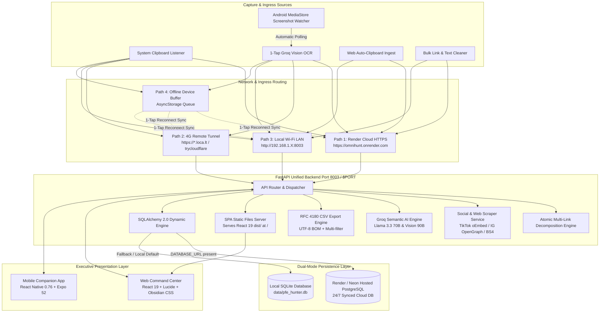
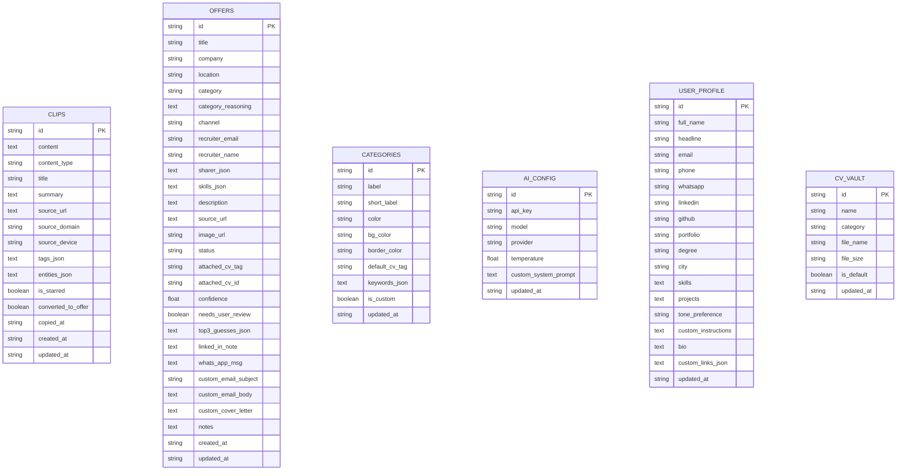
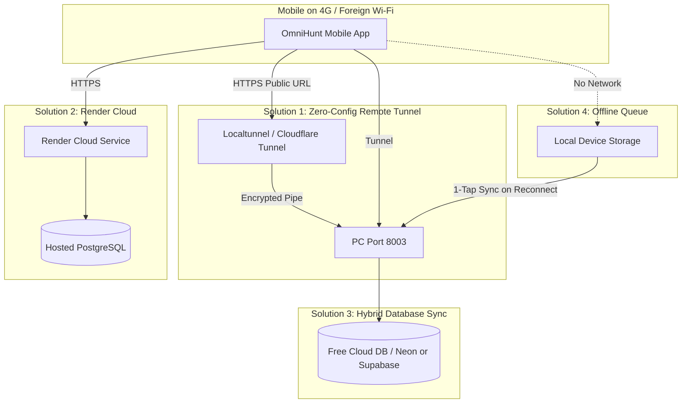

# 🦅 OmniHunt • Application Technical Documentation & Architecture Reference

> **OmniHunt (PFE Hunter Career Command Center)** is an executive-grade, multi-platform intelligence suite designed for capturing, analyzing, categorizing, and executing career opportunities and technical knowledge from web and mobile sources.

---

## 📑 Table of Contents

1. [Executive Overview & Product Vision](#1-executive-overview--product-vision)
2. [High-Level System Architecture](#2-high-level-system-architecture)
3. [Core Subsystems Deep-Dive](#3-core-subsystems-deep-dive)
   - [Universal Clip Vault](#universal-clip-vault)
   - [Multi-Link Decomposition Engine](#multi-link-decomposition-engine)
   - [Web & Social Scraping Engine (TikTok, Instagram, LinkedIn, Web)](#web--social-scraping-engine)
   - [Mobile Intelligent Capture Suite (1-Tap OCR, MediaStore Watcher)](#mobile-intelligent-capture-suite)
   - [Career Pipeline & Outreach Command Center](#career-pipeline--outreach-command-center)
   - [Autonomous Agent Console](#autonomous-agent-console)
4. [Database Architecture & Data Models](#4-database-architecture--data-models)
5. [Complete REST API Specification](#5-complete-rest-api-specification)
6. [Mobile App Architecture (React Native & Native Android)](#6-mobile-app-architecture)
7. [Design System & Styling Architecture](#7-design-system--styling-architecture)
8. [Setup, Deployment & Operation Guide](#8-setup-deployment--operation-guide)
9. [Troubleshooting & Implementation Notes](#9-troubleshooting--implementation-notes)

---

## 1. Executive Overview & Product Vision

OmniHunt bridges the gap between chaotic real-world browsing (on phones and PCs) and structured career execution. Professionals, engineers, and researchers encounter valuable content across multiple fragmented apps: LinkedIn posts with multiple job links, TikTok/Instagram technical reels, GitHub repos, WhatsApp group forwards, recruiter emails, and phone screenshots.

### Key Capabilities
- **Universal Capture**: Seamless ingest from Android clipboard, native screenshots, browser URLs, or messy bulk text dumps.
- **Atomic Multi-Link Decomposition**: Automatically separates posts containing multiple job links or tools into discrete, independently analyzed clips while maintaining parent-post traceability.
- **Deep Groq Semantic AI**: Classifies content with Llama 3.3 70B & Vision 90B, generating executive summaries, key takeaways, skills extraction, tailored cover letters, and outreach messaging.
- **Specialized Social Scrapers**: Extracts full captions, author handles, poster thumbnails, and educational takeaways from TikTok and Instagram links.
- **Pipeline Execution**: Full Kanban application tracker, 1-tap WhatsApp direct messaging, customized email drafting, and CV matching.

---

## 2. High-Level System Architecture

OmniHunt operates on an executive-grade **hybrid tri-tier distributed architecture** engineered for 100% operational flexibility between 24/7 cloud deployment and completely isolated local execution:



### Tri-Tier Architectural Subsystems

1. **Client & Ingestion Tier**:
   - **React Native Mobile App (`mobile/`)**: Native Android client running Expo SDK 52. Features a background MediaStore watcher that detects new phone screenshots in real time, a background clipboard listener, a 1-tap Groq Vision OCR camera module, and a fail-safe offline buffer in `AsyncStorage`.
   - **Web Command Center (`src/`)**: Executive desktop dashboard built on React 19 and Vite. Implements Obsidian Executive styling tokens (high-contrast dark mode, zero CSS framework bloat), a universal Clip Vault inspector, a bulk link/text cleaner, a Kanban pipeline, and an autonomous AI agent console.

2. **Ingress & Transport Tier (Cross-Network Mobility)**:
   - **Cloud Mode (Render)**: Full global HTTPS endpoint (`https://your-app.onrender.com`). Enables synchronization between mobile and web anywhere in the world on any network (cellular 4G/5G, foreign Wi-Fi).
   - **Remote Tunnel Mode (`start_tunnel.bat`)**: Solves RFC 1918 private IP isolation for local PC execution. Exposes local port 8003 over a secure HTTPS pipe (`localtunnel` or `cloudflared`) so the phone on 4G can sync with your PC without opening router ports.
   - **Local LAN Mode**: Direct device-to-device communication over home/office Wi-Fi router on port `8003`.
   - **Offline Buffer Mode**: When the backend is unreachable or the PC is off, captures are buffered locally in `AsyncStorage` under `@pfe_hunter_offline_queue` and flushed with 1-tap upon reconnection.

3. **Compute & Intelligence Tier (`backend/`)**:
   - **FastAPI Core Engine**: Asynchronous Python 3.10+ server providing 34+ REST endpoints.
   - **Multi-Link Decomposition Engine**: Uses regex pattern matching and context slicing to isolate multiple URLs from single LinkedIn/WhatsApp posts, creating discrete child records while maintaining parent-post lineage.
   - **Social Scrapers**: Emulates verified bot headers (`facebookexternalhit/1.1`) and consumes TikTok oEmbed APIs to extract descriptions, author handles, and video thumbnails.
   - **Groq Semantic Intelligence**: Orchestrates `meta-llama/llama-3.2-90b-vision-instruct` for OCR and `meta-llama/llama-3.3-70b-versatile` for skills extraction, classification, and outreach drafting.
   - **CSV Export Engine**: Serializes career pipeline offers into Excel-compliant RFC 4180 CSV with UTF-8 BOM encoding.

4. **Persistence Tier (Dual-Mode Engine)**:
   - **Cloud PostgreSQL**: Used when deployed to Render or when pointing `DATABASE_URL` to a hosted database (Render Postgres, Neon, Supabase).
   - **SQLite Fallback**: Zero-configuration default (`data/pfe_hunter.db`) used when running locally offline without a database server.

---

## 3. Core Subsystems Deep-Dive

### Universal Clip Vault
The Clip Vault (`ClipVaultModel`) is a centralized repository that ingests any snippet of text, code, tool, social video, contact, or job opportunity.

- **Content Categorization**:
  - `job_offer`: Internships, full-time engineering roles, contractor postings.
  - `educational_video`: TikTok / Instagram technical tutorials, coding walkthroughs, AI explainers.
  - `tool_or_repo`: GitHub repositories, developer utilities, libraries.
  - `tech_article`: Blog posts, whitepapers, documentation.
  - `code_snippet`: Formatted code blocks and scripts.
  - `contact`: Recruiter contacts, emails, phone numbers.
  - `note`: Scratchpads, personal notes, meeting takeaways.
- **Clip Inspector Modal**: Clicking any card in Web or Mobile reveals complete scraped text, creator profile, video breakdown, tags, parent-post context, and direct actions (`⚡ Deep AI Enrich`, `💼 Route to Career Offer`, `📋 Copy Text`, `🔗 Source Link`).

---

### Multi-Link Decomposition Engine
When users copy a LinkedIn post, WhatsApp broadcast, or newsletter containing multiple distinct links (e.g., 3 job offers or 4 AI tools):
1. **Context Slicing**: The backend uses regex to identify all URLs (`https?://...`).
2. **Sentence/Paragraph Isolation**: For each URL, the surrounding text is extracted to preserve local context (role requirements, company name, tool description).
3. **Independent Ingestion**: Each URL is scraped and ingested as an independent clip.
4. **Parent Post Traceability**: Every child clip receives `entities.parentPost`:
   ```json
   {
     "batchId": "batch-1791938667",
     "sourceSnippet": "Check out these 3 engineering openings...",
     "linkIndex": 1,
     "totalLinks": 3,
     "allUrls": ["url1", "url2", "url3"]
   }
   ```
5. **UI Badging**: Both Web and Mobile display a green badge `Part of Post (1/3)` linking back to the origin post.

---

### Web & Social Scraping Engine

Located in [`backend/scraper_service.py`](file:///c:/Users/khali/OneDrive/Bureau/learning/nlp/ILIACODE/linkdin%20special/backend/scraper_service.py):

#### 1. TikTok Scraper (`fetch_tiktok_metadata`)
- Uses TikTok's official oEmbed API endpoint:
  `https://www.tiktok.com/oembed?url={target_url}`
- Falls back to OpenGraph bot emulation with headers:
  `User-Agent: facebookexternalhit/1.1 (+http://www.facebook.com/externalhit_uatext.php)`
- Extracts author handle (`@creator`), thumbnail image URL, video title, and caption text.

#### 2. Instagram Scraper (`fetch_instagram_metadata`)
- Bypasses Instagram login walls by emulating crawler bots:
  `User-Agent: Mozilla/5.0 (Windows NT 10.0; Win64; x64) AppleWebKit/537.36 ... facebookexternalhit/1.1`
- Parses `og:description` after the colon delimiter to extract post captions without login prompts.
- Extracts author usernames, poster images, and video flags.

#### 3. General URL Scraper (`scrape_url_metadata`)
- Follows redirects up to 5 hops with a 12-second timeout.
- Extracts OpenGraph tags (`og:title`, `og:description`, `og:image`, `og:site_name`).
- Extracts Twitter Card metadata (`twitter:title`, `twitter:description`, `twitter:image`).
- Strips navigation, headers, footers, scripts, and styles to produce clean body text for LLM enrichment.

#### 4. Bulk Cleaner (`/api/clips/bulk-ingest`)
- Ingests raw messy text (bulleted lists, newline-separated links, mixed paragraphs).
- Identifies URLs or splits by double-newlines and bullet characters (`•`, `-`, `*`, `1.`, `2.`).
- Processes each item independently and returns batch statistics.

---

### Mobile Intelligent Capture Suite

Located in [`mobile/src/services/`](file:///c:/Users/khali/OneDrive/Bureau/learning/nlp/ILIACODE/linkdin%20special/mobile/src/services/):

#### 1. Android MediaStore Watcher (`screenshotWatcher.js`)
- Queries `expo-media-library` for the `Screenshots` album.
- **Timestamp Normalization**: Addresses an Android quirk where MediaStore returns seconds (`1.77e9`) while JavaScript evaluates `Date.now()` in milliseconds (`1.77e12`). Automatically scales seconds to milliseconds:
  ```javascript
  const assetTime = asset.creationTime < 1e11 ? asset.creationTime * 1000 : asset.creationTime;
  ```
- Compares against the last scanned timestamp to eliminate duplicate triggers.

#### 2. 1-Tap Instant Scan
- Prominently placed at the top of [`CaptureScreen.js`](file:///c:/Users/khali/OneDrive/Bureau/learning/nlp/ILIACODE/linkdin%20special/mobile/src/screens/CaptureScreen.js).
- Bypasses file pickers by querying the most recent image in the device gallery, converting to base64, and sending directly to the Groq Vision OCR endpoint.

#### 3. Groq Vision OCR (`/api/clips/ocr-ingest`)
- Uses `meta-llama/llama-3.2-90b-vision-instruct` to extract text verbatim from screenshots of WhatsApp chats, LinkedIn mobile feeds, and job flyers.
- Automatically routes the extracted text into the semantic classification pipeline.

#### 4. Clipboard Watcher (`clipboardWatcher.js`)
- Polls `expo-clipboard` every 2.5 seconds when the app is active.
- Detects new text or URLs, checks against local cache, and submits for categorization.

---

### Career Pipeline & Outreach Command Center

Located in [`backend/models.py`](file:///c:/Users/khali/OneDrive/Bureau/learning/nlp/ILIACODE/linkdin%20special/backend/models.py) and [`src/views/`](file:///c:/Users/khali/OneDrive/Bureau/learning/nlp/ILIACODE/linkdin%20special/src/views/):

- **Kanban Stages**:
  `saved` ➔ `ready` ➔ `applied` ➔ `interview` ➔ `offer` ➔ `rejected`
- **Smart Category Tagging**:
  Auto-categorizes into customizable domains (e.g., `dev-fullstack`, `ai-ml`, `data`, `devops`, `nlp`) with AI-generated reasoning.
- **Direct Outreach Generators**:
  - **WhatsApp Direct**: Pre-fills a conversational note with the recruiter's name and company context.
  - **Email Generator**: Generates professional subject lines and tailored body text.
  - **Custom Cover Letter**: Generates a high-impact cover letter referencing the applicant's profile and skills.
  - **LinkedIn Connection Note**: Generates a concise message (under 300 characters) for connection requests.

---

### Autonomous Agent Console

Located in [`src/views/AgentConsoleView.jsx`](file:///c:/Users/khali/OneDrive/Bureau/learning/nlp/ILIACODE/linkdin%20special/src/views/AgentConsoleView.jsx):

- Interactive agent powered by Groq Llama 3.3 70B (`openai/gpt-oss-120b`).
- Direct access to live database context: offers, clips, categories, user profile.
- Executes actions: categorizing offers, filtering high-value roles, drafting tailored outreach, and summarizing daily captures.

---

## 4. Database Architecture & Data Models

Database engine: **SQLite** via SQLAlchemy.
File path: `backend/pfe_hunter.db`

### Entity-Relationship Diagram



---

## 5. Complete REST API Specification

Base URL: `http://localhost:8003`

### Health & Network
| Method | Endpoint | Description |
| :--- | :--- | :--- |
| `GET` | `/api/health` | Health check with database connection test. |
| `GET` | `/api/db/stats` | Counts of offers, clips, categories, CVs, and AI config. |
| `GET` | `/api/network-info` | Local IPv4 addresses for mobile app pairing. |
| `GET` | `/api/mobile/pairing` | Pairing QR payload and local endpoint status. |

### Clip Vault Engine
| Method | Endpoint | Description |
| :--- | :--- | :--- |
| `GET` | `/api/clips` | Fetch all clips with optional category/type filters. |
| `POST` | `/api/clips/ingest` | Ingest single clip, URL, or multi-link post. Decomposes multi-link posts into discrete child clips. |
| `POST` | `/api/clips/bulk-ingest` | Ingest bulk messy text or URL lists, cleaning and creating discrete clips. |
| `POST` | `/api/clips/{clip_id}/enrich` | Deep semantic enrichment: re-scrapes target URL, extracts takeaways, creator handle, and tools. |
| `POST` | `/api/clips/ocr-ingest` | Process base64 screenshot via Groq Vision OCR into text. |
| `POST` | `/api/clips/{clip_id}/convert-to-offer`| Convert any clip into an active career job offer. |
| `PATCH` | `/api/clips/{clip_id}/star` | Toggle starred status of a clip. |
| `DELETE` | `/api/clips/{clip_id}` | Remove a clip from the vault. |
| `POST` | `/api/clips/sync-all` | Batch synchronization endpoint for mobile offline sync. |

### Career Offers & Pipeline
| Method | Endpoint | Description |
| :--- | :--- | :--- |
| `GET` | `/api/offers` | Fetch all career offers with sorting and category filters. |
| `POST` | `/api/offers` | Create a new offer manually or programmatically. |
| `POST` | `/api/offers/sync` | Sync multiple offers from mobile clients. |
| `PUT` | `/api/offers/{offer_id}` | Update offer details (status, notes, recruiter info). |
| `PATCH`| `/api/offers/{offer_id}/status` | Update pipeline stage (`saved` ➔ `ready` ➔ `applied` etc.). |
| `DELETE`| `/api/offers/{offer_id}` | Delete an offer. |
| `POST` | `/api/mobile/ingest` | Legacy mobile ingestion endpoint. |

### AI, Profile & Settings
| Method | Endpoint | Description |
| :--- | :--- | :--- |
| `GET` | `/api/profile` | Retrieve the active candidate profile. |
| `POST` | `/api/profile` | Update candidate profile, CV links, and preferences. |
| `GET` | `/api/cvs` | List stored CV profiles in CV Vault. |
| `POST` | `/api/cvs` | Add or update a CV profile. |
| `GET` | `/api/categories` | Retrieve all career categories and keyword triggers. |
| `POST` | `/api/categories` | Create or update custom categories and badge colors. |
| `DELETE`| `/api/categories/{id}` | Delete a custom category. |
| `GET` | `/api/ai-config` | Get AI model settings (Groq API key, model, temperature). |
| `POST` | `/api/ai-config` | Update Groq API key and model selection. |
| `POST` | `/api/ai/analyze` | Run semantic analysis on arbitrary text. |
| `POST` | `/api/ai/complete` | Generic Groq LLM completion. |
| `POST` | `/api/ai/chat` | Autonomous Agent Console chat endpoint. |
| `GET` | `/api/scrape` | Scrape metadata and readable text from any URL. |

---

## 6. Mobile App Architecture

The mobile application is built with **React Native** and **Expo SDK 52**.

```
mobile/
├── App.js                   # Root navigation with Bottom Tab Navigator & Haptic Notifications
├── app.json                 # Expo configuration & Android native permissions
├── package.json             # React Native, Expo 52, AsyncStorage
├── build_apk.py             # Automated standalone Gradle APK compiler
├── src/
│   ├── theme.js             # Obsidian executive palette & typography tokens
│   ├── services/
│   │   ├── api.js           # Axios HTTP client, offline AsyncStorage sync, AI chat
│   │   ├── clipboardWatcher.js # Polling clipboard watcher with deduping
│   │   └── screenshotWatcher.js# MediaStore Screenshots album watcher & 1-tap scan
│   └── screens/
│       ├── DashboardScreen.js   # Pipeline metrics, quick actions
│       ├── CaptureScreen.js     # 1-Tap OCR, MediaStore status, Bulk & Single Ingest
│       ├── ClipVaultScreen.js   # Universal Vault with Clip Inspector Modal
│       ├── AgentScreen.js       # Conversational AI Career Agent (Groq Llama 3.3 70B)
│       ├── OffersListScreen.js  # Searchable career offers stream
│       ├── OfferDetailScreen.js # Full offer inspector, WhatsApp 1-Tap, Cover Letter
│       └── ConnectScreen.js     # LAN pairing, IP configuration, ping test
```

### Standalone Android Build Process
The project includes a standalone compilation script: [`mobile/build_apk.py`](file:///c:/Users/khali/OneDrive/Bureau/learning/nlp/ILIACODE/linkdin%20special/mobile/build_apk.py).
Executing `python mobile/build_apk.py`:
1. Validates Android SDK environment (`ANDROID_HOME`).
2. Runs Expo Prebuild to generate the native Android project.
3. Invokes `./gradlew assembleRelease` using Gradle 8.9.
4. Generates a signed release APK: `omnihunt-mobile.apk` (56.6 MB).
5. Copies the binary to `public/omnihunt-mobile.apk` for instant browser download.

---

## 7. Design System & Styling Architecture

Both Web and Mobile interfaces strictly adhere to the **Obsidian Executive Design System**:

| Token Name | Color Hex | Role |
| :--- | :--- | :--- |
| **Obsidian Black** | `#09090b` | App background, window canvases |
| **Card Zinc** | `#18181b` | Surfaces, modals, cards |
| **Titanium Border**| `#27272a` | High-contrast structural dividers |
| **Pure White** | `#ffffff` | Primary headings, active labels |
| **Muted Slate** | `#a1a1aa` | Secondary descriptions, timestamps |
| **Emerald Green** | `#10b981` | Success states, active badges, AI highlights |
| **Amber Gold** | `#f59e0b` | Action prompts, warnings, stars |

### Design Principles
- **No External CSS Bloat**: Standardized CSS variables and tokens.
- **Micro-Animations**: Transitions (`150ms-250ms ease`), subtle hover glows, and responsive touch feedback.
- **Strict English Localization**: Standardized professional English across all UI labels, notifications, and prompts.

---

## 8. Setup, Deployment & Operation Guide

### Prerequisites
- Node.js (v18+) & npm
- Python (v3.10+)
- Android Studio / Android SDK (only required if compiling native APKs locally)
- Groq API Key (for Llama 3.3 and Vision inference)

---

### Step 1: Clone & Configure

```bash
git clone https://github.com/Ysn-Ir/CopyLinkdinPaste.git
cd CopyLinkdinPaste
```

Create a `.env` file in the project root:
```env
GROQ_API_KEY=gsk_your_groq_api_key_here
PORT=8003
HOST=0.0.0.0
```

---

### Option A: 1-Click Silent Background Mode (No Terminal Windows!)
To run OmniHunt without keeping open CMD or PowerShell windows:
- Double click **`start_background.vbs`** or run `start.bat` and select Option 1.
- Both the Web Command Center and all APIs run silently in the background on:
  👉 **`http://localhost:8003`**
- To terminate background processes: Double click **`stop_background.bat`**.

---

### Option B: 1-Command Docker Deployment (Recommended for Cloud / Server)
```bash
docker compose up -d --build
```
- Web Application & API: `http://localhost:8003`
- Web Frontend (Nginx): `http://localhost:5174`
- PostgreSQL: `localhost:5432`
- Native Tesseract OCR is baked directly into the Docker image with English and French language packs.

---

### Option C: Local Dev Mode (Interactive Terminals)
```bash
# Terminal 1 - FastAPI Backend (Port 8003)
python -m uvicorn backend.main:app --host 0.0.0.0 --port 8003 --reload

# Terminal 2 - Vite Frontend (Port 5174)
npm run dev
```

---

### Option D: 1-Click Render Cloud Deployment (24/7 Global Access & Hosted DB)

OmniHunt provides a pre-configured **`render.yaml`** blueprint for instant, 1-click cloud deployment on [Render](https://render.com).

> [!NOTE]
> **Cloud deployment is completely optional.** OmniHunt is designed with 100% parity between local (PC / Docker) and cloud (Render) environments.

#### Architecture on Render:
1. **Managed PostgreSQL Database** (`omnihunt-postgres`): Hosted cloud database that guarantees real-time synchronization between the mobile app (on cellular 4G/5G) and the web app from anywhere on Earth.
2. **Unified Web Service** (`omnihunt`): Builds the React 19 SPA frontend with `npm run build` and serves both the static web assets and the full FastAPI REST API from a single container on `$PORT`.

#### How to Deploy:
1. Push your repository to GitHub or GitLab.
2. In Render Dashboard, click **New +** -> **Blueprint**.
3. Select your repository. Render will automatically parse `render.yaml` and provision:
   - A managed PostgreSQL instance.
   - A unified Python web service.
4. Set the `GROQ_API_KEY` environment variable in the Render dashboard.
5. Once deployed, Render generates a permanent HTTPS URL:
   👉 **`https://your-omnihunt.onrender.com`**
6. Open your mobile app -> Go to **Connect / Settings** -> Select the **Render Cloud** profile -> Tap **Test Ping**. All devices are now synchronized 24/7!

---

### Option E: Local Deployment Cross-Network Sync (Phone on 4G / Outside Home)

#### The Problem:
When running OmniHunt locally on your PC (`http://192.168.1.X:8003`), the phone can communicate with the PC only while connected to the **same local Wi-Fi router**. If your phone leaves home, switches to cellular 4G/5G, or connects to a different network (coffee shop, university, office), it cannot reach `192.168.1.X` because private RFC 1918 IPs cannot be routed across the public internet without port forwarding.

#### 4 Battle-Tested Solutions Provided by OmniHunt:



| Solution | Mechanism | Setup Time | Router Config | Cost |
| :--- | :--- | :--- | :--- | :--- |
| **1. Zero-Config Remote Tunnel** | Run `start_tunnel.bat` or `start.bat` Option [6] | 5 seconds | None | Free |
| **2. Render Cloud Deployment** | Blueprint `render.yaml` | 2 minutes | None | Free Tier |
| **3. Tailscale Mesh** | Tailscale app on PC & Phone | 1 minute | None | Free |
| **4. Mobile Offline Queue** | Automatic device buffering in `AsyncStorage` | 0 seconds (Built-in) | None | Free |

##### How to Use Solution 1 (Remote Tunnel Wizard):
1. On your PC, run **`start_tunnel.bat`** (or run `start.bat` and select `[6]`).
2. The script starts a secure public HTTPS tunnel via `localtunnel` (or `cloudflared`).
3. It prints a public URL, for example: `https://pfe-hunter.loca.lt`.
4. In your OmniHunt Mobile App, tap **Settings / Connect**, paste the HTTPS URL, and tap **Test Ping**.
5. Your phone can now capture offers, run Groq Vision OCR, and sync data from cellular 4G/5G anywhere in the world!

##### How Solution 4 (Fail-Safe Offline Queue) Works:
If you are outside with zero internet connection or your PC is shut down:
- The mobile app intercepts failed network requests and buffers captures into local `AsyncStorage` under `@pfe_hunter_offline_queue`.
- A prominent amber badge appears on the Connect screen: `X Offline Items Buffered`.
- As soon as you reconnect (via Wi-Fi, tunnel, or Render), tap **Sync Now** to push all buffered offers and clips directly to the database. Zero data is ever lost!

---

### Step 5: Exporting Career Offers to CSV

OmniHunt provides one-click CSV export of all career offers across both Web and Mobile interfaces:

#### API Endpoint:
- **`GET /api/offers/export/csv`**
  - **Query Parameters**:
    - `category`: Filter by technical domain (e.g. `Machine Learning`, `Fullstack`, `all`).
    - `channel`: Filter by sourcing channel (`linkedin`, `email`, `whatsapp`, `all`).
    - `status`: Filter by pipeline stage (`scouted`, `applied`, `interview`, `all`).
  - **Features**:
    - RFC 4180 standard escaping for multi-line job specifications and quotes.
    - UTF-8 Byte Order Mark (`\ufeff`) header for native Microsoft Excel character rendering.
    - Direct browser download via `Content-Disposition: attachment; filename="omnihunt_offers_<timestamp>.csv"`.
    - Includes 19 comprehensive columns: `id`, `title`, `company`, `location`, `workplace_type`, `contract_type`, `salary`, `domain`, `skills`, `application_channel`, `status`, `relevance_score`, `source_url`, `contact_name`, `contact_email`, `contact_phone`, `outreach_status`, `scouted_at`, and `job_specification`.

#### User Interface Access:
1. **Web Dashboard**: Click **📥 Export All Offers (CSV)** in the Quick Action toolbar.
2. **Web Command Center**: Click the **CSV** button in the filter and search toolbar.
3. **Mobile App**: Tap the **📥 CSV** button at the top of the Offers list to open and download the CSV directly on your phone.

---

## 9. Troubleshooting & Implementation Notes

### Android Screenshot Watcher Timing
- **Issue**: MediaStore timestamps are in seconds on Android (`~1.77e9`), while JavaScript's `Date.now()` is in milliseconds (`~1.77e12`).
- **Fix**: Timestamps must be normalized before delta calculation:
  ```javascript
  const assetMs = asset.creationTime < 1e11 ? asset.creationTime * 1000 : asset.creationTime;
  ```

### Instagram & TikTok Bot Headers
- Unauthenticated requests to Instagram or TikTok return login redirects or minimal shells.
- Scraper requests must supply social bot headers (`facebookexternalhit/1.1`) to trigger server-rendered OpenGraph metadata containing descriptions, creator handles, and poster images.

### Cross-Origin & Local IP Discovery
- When testing on a physical phone, ensure your PC firewall allows inbound connections on port `8003`.
- The Web Command Center includes a **Mobile Connect** modal that displays your PC's active LAN IPv4 address (e.g. `http://192.168.1.X:8003`) along with an auto-generated pairing QR code.
