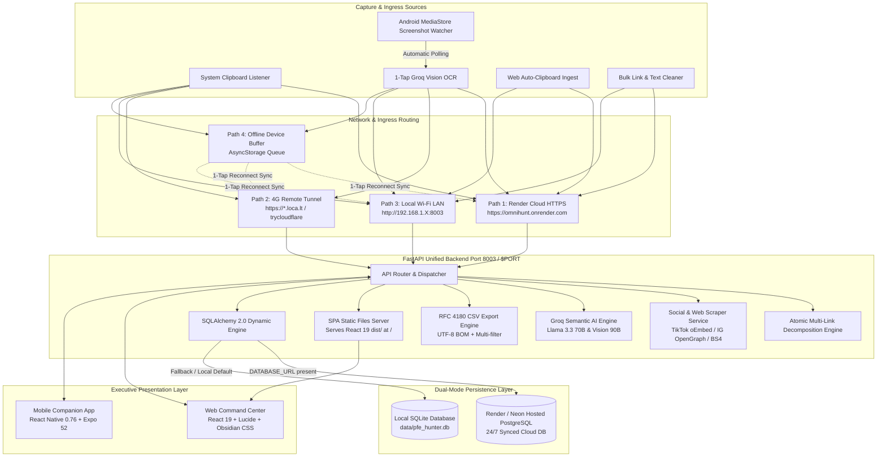

# 🦅 OmniHunt • Multi-Platform Career Intelligence Suite

[](https://fastapi.tiangolo.com)
[](https://vitejs.dev)
[](https://expo.dev)
[](https://groq.com)
[](https://www.postgresql.org)
[](https://render.com)
[](#)

> **OmniHunt** is an executive-grade, multi-platform intelligence command center designed to capture, organize, analyze, and execute career opportunities, developer tools, educational reels, and technical content across Android mobile and desktop web.

---

## 📑 Table of Contents

- [System Architecture](#-system-architecture)
- [⚡ Key Highlights & Innovations](#-key-highlights--innovations)
- [🌐 Cross-Network Mobility: Solving the 4G Mobile Problem](#-cross-network-mobility-solving-the-4g-mobile-problem)
- [🚀 Deployment & Running Options](#-deployment--running-options)
  - [Option 1: 1-Click Silent Background Mode](#option-1-1-click-silent-background-mode-pc)
  - [Option 2: 1-Click Remote 4G Tunnel](#option-2-1-click-remote-4g-tunnel-cellular-access)
  - [Option 3: 1-Click Render Cloud Deployment](#option-3-1-click-render-cloud-deployment-247-global-access)
  - [Option 4: 1-Command Docker Deployment](#option-4-1-command-docker-deployment)
  - [Option 5: Local Dev Mode](#option-5-local-dev-mode)
- [📱 Mobile Companion App](#-mobile-companion-app)
- [📊 1-Click Offers CSV Export](#-1-click-offers-csv-export)
- [🔌 REST API Quick Reference](#-rest-api-quick-reference)
- [🛠️ Technology Stack](#️-technology-stack)
- [📚 Full Documentation](#-full-documentation)

---

## 🏛️ System Architecture

OmniHunt operates on a **hybrid tri-tier distributed architecture** engineered for 100% operational flexibility between 24/7 cloud deployment and completely isolated local execution:



---

## ⚡ Key Highlights & Innovations

- **Universal Clip Vault**: Centralized repository ingesting job postings, GitHub repositories, educational TikTok/Instagram reels, code snippets, notes, and recruiter contacts.
- **Atomic Multi-Link Decomposition**: Automatically isolates multiple URLs inside a single LinkedIn post or message, ingesting each independently while preserving the source post reference (`entities.parentPost`).
- **Render Cloud Deployment (Optional)**: 1-Click deployment via `render.yaml` with hosted PostgreSQL database. Keeps web and mobile 100% synchronized 24/7 with zero PC required.
- **Remote 4G Tunnel Wizard (`start_tunnel.bat`)**: Solves NAT/cellular isolation. Exposes local port 8003 over a secure public HTTPS link so your phone on 4G syncs with your PC with zero router configuration!
- **Fail-Safe Offline Ingestion Queue**: Buffer captures and clips on device when disconnected; auto-syncs to database upon reconnect.
- **1-Click CSV Export**: Comprehensive export of all career opportunities across Web and Mobile with Excel UTF-8 BOM compatibility.
- **Mobile 1-Tap & MediaStore Screenshot Watcher**: Real-time Android screenshot detection with 1-tap Groq Vision OCR (`llama-3.2-90b-vision-instruct`).
- **Specialized Social Scrapers**: Extracts full captions, author handles, video thumbnails, and educational takeaways from TikTok and Instagram links.
- **Bulk Link & Text Cleaner**: Ingests and decomposes messy lists of links, bulleted points, or notes into discrete clips.
- **Interactive Clip Inspector**: Click any clip to review full scraped text, author profile, video breakdown, and trigger deep AI enrichment.
- **Outreach Generator**: 1-tap pre-filled WhatsApp messages, customized cover letters, and email outreach.
- **Obsidian Executive Design**: High-contrast, typography-first dark mode (`#09090b` obsidian, zinc card surfaces, titanium borders, emerald accents).

---

## 🌐 Cross-Network Mobility: Solving the 4G Mobile Problem

When running OmniHunt locally on your PC, it binds to a private IP (e.g. `192.168.1.12`). If your phone is on **cellular 4G/5G** or outside your home Wi-Fi, it cannot reach your PC directly due to router NAT/firewall restrictions.

OmniHunt provides 4 complementary solutions:

| Mode | Mechanism | PC Needed? | Network Requirement | Setup Effort |
| :--- | :--- | :--- | :--- | :--- |
| **1. 4G Remote Tunnel** | `start_tunnel.bat` (`localtunnel` / `cloudflared`) | Yes | Phone on any 4G/5G/Wi-Fi | **5 seconds (1 click)** |
| **2. Render Cloud** | `render.yaml` Blueprint + Hosted PostgreSQL | **No** | Works 24/7 worldwide | **2 minutes** |
| **3. Offline Queue** | On-device `AsyncStorage` buffer | No | Offline / No signal | **Automatic** |
| **4. Local Wi-Fi** | Port 8003 binding on LAN | Yes | Phone & PC on same Wi-Fi | **Instant** |

---

## 🚀 Deployment & Running Options

Both Cloud and Local deployments are **100% optional** with complete feature parity. Choose the mode that fits your workflow:

### Option 1: 1-Click Silent Background Mode (PC)
Runs both the FastAPI backend and Web Command Center silently in the background with **NO open terminal windows**:
```bash
# Double-click start_background.vbs OR run start.bat and select [1]
start.bat
```
- 👉 Access Web App & API: **`http://localhost:8003`**
- Stop background processes anytime via `stop_background.bat` (or `start.bat [4]`).

### Option 2: 1-Click Remote 4G Tunnel (Cellular Access)
Expose your local PC backend to an encrypted public HTTPS URL for mobile access outside home:
```bash
# Double-click start_tunnel.bat OR run start.bat and select [6]
start_tunnel.bat
```
1. Copy the generated URL (e.g., `https://pfe-hunter.loca.lt`).
2. In the OmniHunt Mobile App, open **Connect / Settings**, paste the URL, and tap **Test Ping**.
3. Your phone on 4G now communicates directly with your PC backend!

### Option 3: 1-Click Render Cloud Deployment (24/7 Global Access)
Deploy the full stack to Render using the pre-configured Blueprint:
1. Push this repository to GitHub or GitLab.
2. In [Render Dashboard](https://dashboard.render.com), click **New +** -> **Blueprint**.
3. Select your repository. Render will automatically parse `render.yaml` and provision:
   - **`omnihunt-postgres`**: Managed PostgreSQL database.
   - **`omnihunt`**: Unified web service running FastAPI and serving the React 19 SPA.
4. Set `GROQ_API_KEY` in Render environment settings.
5. You receive a permanent HTTPS URL: `https://your-omnihunt.onrender.com`.
6. Select the **Render Cloud** profile in the mobile app. All devices are synchronized 24/7!

### Option 4: 1-Command Docker Deployment
```bash
docker compose up -d --build
```
- Web Application & API: `http://localhost:8003`
- Web Frontend (Nginx): `http://localhost:5174`
- PostgreSQL: `localhost:5432`
- Includes pre-installed Tesseract OCR with English and French language packs.

### Option 5: Local Dev Mode
```bash
# Terminal 1: FastAPI Backend
python -m uvicorn backend.main:app --host 0.0.0.0 --port 8003 --reload

# Terminal 2: Vite React Frontend
npm run dev
```

---

## 📱 Mobile Companion App

- **Direct APK Installation**: Download `omnihunt-mobile.apk` (55.28 MB) directly from the Web Command Center or the root repository folder.
- **Expo Go Development**:
  ```bash
  cd mobile
  npm install
  npx expo start
  ```
- **Connection Profiles Supported**:
  - 🌐 **Render Cloud**: Connects to `https://*.onrender.com` 24/7 from anywhere.
  - ⚡ **Remote 4G Tunnel**: Connects to `https://*.loca.lt` generated by `start_tunnel.bat`.
  - 🏠 **Home Wi-Fi LAN**: Connects to `http://192.168.1.X:8003`.
  - 🔒 **Tailscale Mesh**: Connects to `http://100.X.Y.Z:8003`.

---

## 📊 1-Click Offers CSV Export

OmniHunt provides instant CSV export of all career opportunities:

- **Web Dashboard**: Click **📥 Export All Offers (CSV)** in the Quick Action toolbar.
- **Web Command Center**: Click the **CSV** button in the filter toolbar.
- **Mobile App**: Tap the **📥 CSV** button at the top of the Offers screen.
- **REST API**:
  ```http
  GET /api/offers/export/csv?category=all&channel=all&status=all
  ```
  - Standard RFC 4180 escaping for multi-line job specifications.
  - Native Microsoft Excel compatibility via UTF-8 Byte Order Mark (`\ufeff`).
  - Includes 19 exhaustive columns: Title, Company, Location, Contract, Salary, Domain, Skills, Recruiter Contacts, Application Channel, Status, Relevance Score, and Job Specification.

---

## 🔌 REST API Quick Reference

| Method | Endpoint | Description |
| :--- | :--- | :--- |
| `GET` | `/api/offers` | Fetch filtered career opportunities |
| `GET` | `/api/offers/export/csv` | Download complete RFC 4180 CSV export of offers |
| `PATCH` | `/api/offers/{id}/status` | Update pipeline stage (`scouted`, `applied`, `interview`, etc.) |
| `GET` | `/api/clips` | Fetch clips from Universal Clip Vault |
| `POST` | `/api/clips/ingest` | Ingest and classify new clipboard clip |
| `POST` | `/api/clips/bulk-ingest` | Decompose and ingest bulk text or lists of URLs |
| `POST` | `/api/clips/ocr-ingest` | Ingest phone screenshot via Groq Vision OCR |
| `POST` | `/api/clips/{id}/enrich` | Deep semantic enrichment (takeaways, tags, key skills) |
| `POST` | `/api/clips/{id}/convert-to-offer` | Route vault clip into career pipeline offer |
| `POST` | `/api/ai/chat` | Chat with autonomous Career Agent |
| `GET` | `/api/mobile/pairing` | Network pairing metadata & IP discovery |

---

## 🛠️ Technology Stack

| Component | Technologies |
| :--- | :--- |
| **Web Frontend** | React 19, Vite, Lucide Icons, Pure Obsidian Executive CSS |
| **Mobile Client** | React Native 0.76, Expo SDK 52, `expo-media-library`, `expo-clipboard`, AsyncStorage |
| **Backend API** | Python 3.10+, FastAPI, SQLAlchemy 2.0, Pydantic v2, Uvicorn |
| **Databases** | Hosted PostgreSQL (Render / Neon / Supabase) + SQLite (`pfe_hunter.db`) fallback |
| **AI Inference** | Groq Cloud SDK (`llama-3.3-70b-versatile`, `llama-3.2-90b-vision-instruct`) |
| **Social Scrapers** | HTTPX, BeautifulSoup4, TikTok oEmbed API, Instagram OpenGraph Bot Emulation |
| **Container & Cloud** | Docker, Docker Compose, Render Blueprint (`render.yaml`), Localtunnel |

---

## 📚 Full Documentation

For the full architectural specification, complete REST API catalog (34+ endpoints), data schemas, and troubleshooting runbooks, see:

👉 **[DOCUMENTATION.md](file:///c:/Users/khali/OneDrive/Bureau/learning/nlp/ILIACODE/linkdin%20special/DOCUMENTATION.md)**
